# Assignment1_CV

# Part 1: Filters and Edges

Code is in `convolution.py`, `filters_helpers.py` and `part1.ipynb`. 
From 1.2 on, every blur and derivative runs on separable convolution (`conv2d_sep`).
Images are grayscale and max 1000 px on the longer side.

## 1.1 Convolution from scratch

2D convolution were written in 3 versions. 
All of them flip the filter (convolution is correlation with the flipped filter) and zero pad, so the output is the same size as the input.

- **Loop:** loops over every pixel and every filter entry.
- **Vectorized:** no loop over pixels. It loops over the filter entries only, adding filter value × a shifted copy of the whole padded image each time.
- **Separable:** checks if the filter is rank 1 using its SVD (second singular value ~ 0 compared to the first, rounding tolerance 1e-10). If yes, it convolves with the column then the row. If not, it uses the vectorized version.


**Check:**   
50 trials were ran on small random images (sides: 5~24). Each trial used a random non-separable filter and a random separable one (outer product of a random column and row), with random odd sizes from 1 to 9. All three versions matched `scipy.signal.convolve2d(mode="same")` (`np.allclose`, atol 1e-10), so they agree to rounding error "tol".

**Timing:**   
Random 256 × 256 image, Gaussian filters from 3 × 3 to 31 × 31 (sigma = size / 6). All of them are rank 1, so the separable version always takes its fast path.

```  
  size   loop (s)   vectorized (s)   separable (s)
  3x3       0.187           0.0004          0.0005
  5x5       0.462           0.0011          0.0006
  7x7       0.888           0.0020          0.0007
  9x9       1.478           0.0047          0.0015
 11x11      2.108           0.0051          0.0010
 13x13      2.918           0.0071          0.0012
 15x15      3.785           0.0089          0.0013
 17x17      4.818           0.0116          0.0014
 19x19      8.403           0.0161          0.0019
 21x21     10.031           0.0199          0.0029
 23x23     13.211           0.0337          0.0019
 25x25     17.589           0.0319          0.0033
 27x27     18.808           0.0506          0.0044
 29x29     23.704           0.0409          0.0023
 31x31     26.248           0.0684          0.0030

```

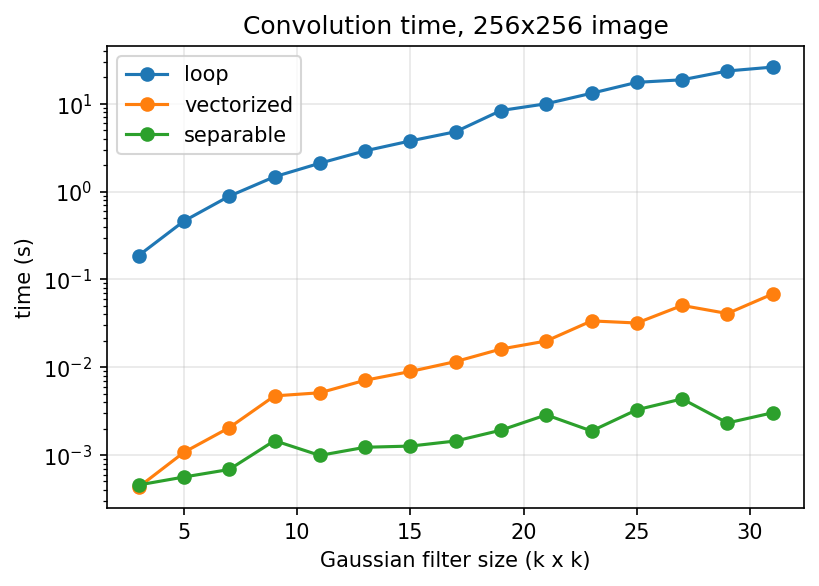

**Why the times are different:**
- **Loop:** about H·W·k² multiply-adds, done one by one by the Python, so it is by far the slowest and grows with k², where time is 26.248 s.
- **Vectorized:** only k² Python iterations, and each one is a whole-image NumPy operation running in compiled code. The arithmetic is still O(H·W·k²), but each operation is much cheaper, so it is much faster than the loop, where time is 0.0684 s.
- **Separable:** two 1D passes cost 2k whole-image operations instead of k², so it grows linearly with k and the gap to the vectorized version gets bigger with filter size, where time is 0.0030 s. The SVD test costs almost nothing because the filter is small.

## 1.2 Finite difference operator

An edge is a sharp change in intensity, and derivatives measure change (in our case change from the px before and after). The grayscale image was filtered with Dx = [1 0 -1] and Dy = Dx transposed, the gradient magnitude was calculated and thresholded. Repeated for both example images (cameraman & facade). Derivative maps are shown with zero as mid-gray.

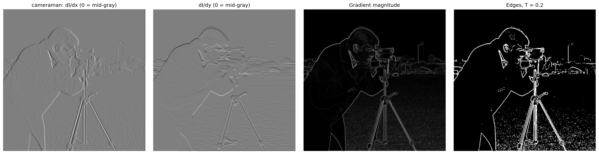

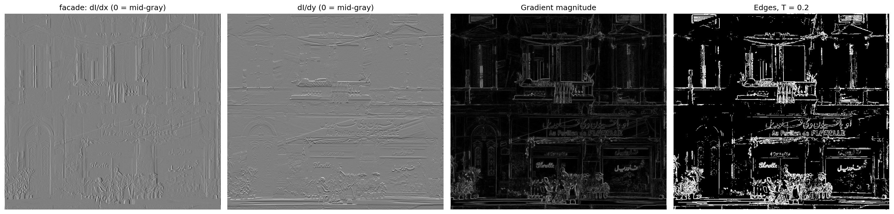

**Threshold:** swept T = 0.05, 0.1, 0.2, 0.3, 0.4 and picked T = 0.2 for both images.
- **Facade:** at 0.05 and 0.1 the wall and the shutters fill with speckle that hides the structure. At 0.3 and 0.4 the window outlines and the door arch start breaking up. At 0.2 the windows, balcony, arch and signs stay clean and the flat wall is black.
- **Cameraman:** Simillar results for camera man, at 0.05 and 0.1 grass and cameraman's coat are filled with speckles, at 0.3 and 0.4 distant edges start disappearing and cameraman's edges start breaking up and fine details aroud edges are gone. At 0.2 cameraman's edges are most outlides with little loss, downto the coat buttons and distant structures.    

**Lines along the frame:** with zero padding the convolution assumes black (0) outside the image. On the first and last row and column the filter compares a real pixel with a fake black one, so it sees a big step wherever the border is brighter than the threshold. Dx makes the lines on the left and right sides and Dy on the top and bottom. They are not real edges, only the padding - yet they correspond to an edge, and therefore theres a white aura around the image (a gray border is added for visibility). With reflect padding there is no fake step and the lines are gone.

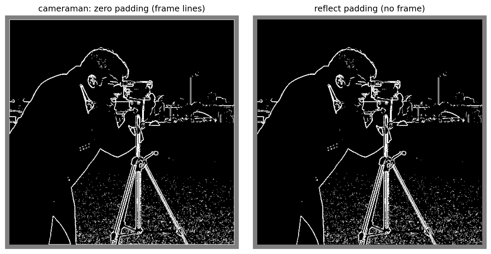

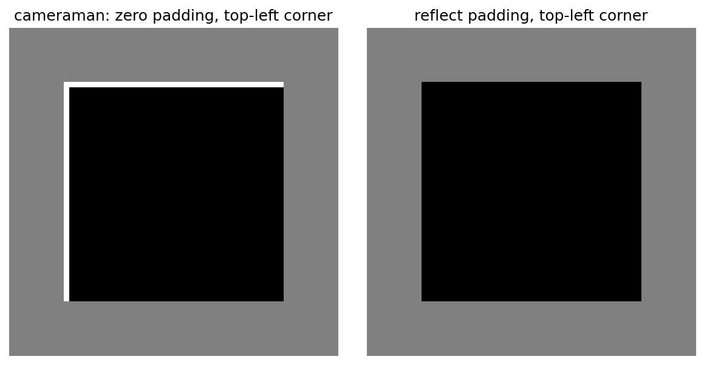


## 1.3 Derivative of Gaussian (DoG)

Derivatives amplify noise, so one solution is to blur before differentiating. Convolution is associative, so the blur and the derivative can be one filter. To get the two DoG filters, a 2D Gaussian (sigma = 2, 13 × 13) was built and the kernel was filtered with Dx and Dy. Each one was then applied to the image with a single convolution. Then the same steps as 1.2 were repeated.

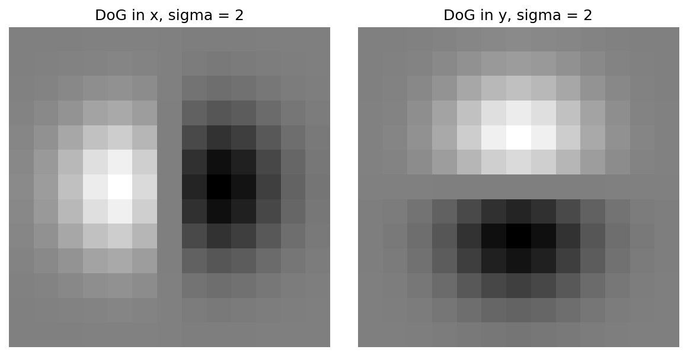

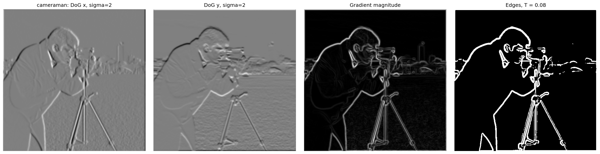


**Parameters:** sigma = 2, T = 0.08 for the cameraman and T = 0.06 for the facade, again from a sweep (0.02, 0.04, 0.06, 0.08, 0.12). On the facade, 0.04 leaves blobs on the walls, 0.06 gives clean walls with continuous contours, and from 0.08 the door arch and thin contours start to disappear. T = 0.8, on cameraman image, achieves best tradeoff with clearest edges.

**Check:** one DoG convolution matches blur first then differentiate, up to about 0.002. That small difference is just from cutting the Gaussian to 13 × 13.


**How the maps differ from 1.2:**
- Smoother. The speckle on textured areas (grass, wall plaster, shutters) is gone.
- Edges are continuous and thicker, while 1.2 gives thin broken lines.
- Fine detail is lost. Only the main structure survives.
- Gradient values are smaller (due to smoothing), so the threshold had to go down from 0.2 to 0.08 and 0.06.

**Why:**
- A derivative compares neighboring pixels, so any small random change gives a big response. In 1.2 it sees the raw pixels, so noise and texture become edges.
- The DoG blurs and differentiates in one step, since (I * G) * Dx = I * (G * Dx). The Gaussian averages neighbors first, so noise and texture are smoothed out before the derivative and only changes that last over a few pixels remain.
- The same averaging spreads each edge over about sigma pixels, so the contours get thicker and the peak gradient drops, which is why the threshold is lower.
- A bigger sigma would remove more detail and make thicker edges, a smaller sigma would be closer to 1.2.

# Part 2: Frequencies, Pyramids and Blending

Code is in `Hybrid_img.py` (low-pass, high-pass, hybrid), `convolution.py`, `2_1.ipynb` and `2_2.ipynb` (OTHER PARTS TO BE IMPLEMENTED 2.3 W 2.4). All blurs use the separable convolution `conv2d_sep` with reflect padding. The Gaussian kernel for a given sigma is 2·ceil(3σ)+1 wide, and color images are filtered one channel at a time.

## 2.1 Hybrid images

A blur keeps the low frequencies of an image, and the image minus its blur keeps the high ones. A hybrid adds the high frequencies of one image to the low frequencies of another. Up close the high frequencies dominate, and from far away only the low ones are visible, so the picture changes with viewing distance.

For each pair processing was as folllows:
- Aligned the second image to the first with `align_images.py`, then cropped both to the same frame.
- Low-passed the first image with a Gaussian (σ_low).
- High-passed the second: the image minus its own Gaussian blur (σ_high).
- Added the two and clipped to [0, 1].

Sigma sets the cutoff frequency. A Gaussian with σ pixels keeps frequencies below about 1/(2πσ) cycles per pixel, so a bigger σ means a lower cutoff.

The three hybrids:
All three were had the following sigmas: σ_low = 7, σ_high =4.
- **Man + cat**: man low-passed, cat high-passed. Up close, the cat's fur, whiskers and eyes fill the face. The man supplies the face shape, hairline, ears and skin tone, and his mouth shows below the cat's nose. This one worked best.
- **elrayes + lion:** elrayes low-passed, lion high-passed. The eyes, nose and mouth line up well, so the lion's fur and whiskers sit on the right features. What remains of the man is his suit, tie and skin tone.
- **Deer + frog:** deer low-passed, frog high-passed. The eyes line up. Up close the frog's eyes, skin texture and mouth outline stand out, and the deer provides the soft face shape, ears and background.

**Failure case (deer + frog):** this is the weakest of the three.
- The frog's eyes and mouth outline are large, high-contrast structures. A σ_high of 4 lets them through, so they stay visible even when the image is small, and the deer never fully takes over.
- The face geometry doesn't match. The frog's wide, low mouth doesn't fit the deer's muzzle, so the result looks like a double exposure instead of one face.
- The deer's low-pass has few distinctive cues besides the ears and the background, so the deer is hard to recognize from far away.

**Where the other hybrids fall short:** in elrayes + lion, the lion's fine texture also spills onto the suit and neck, and a green patterned background from the lion image shows at the top corners.

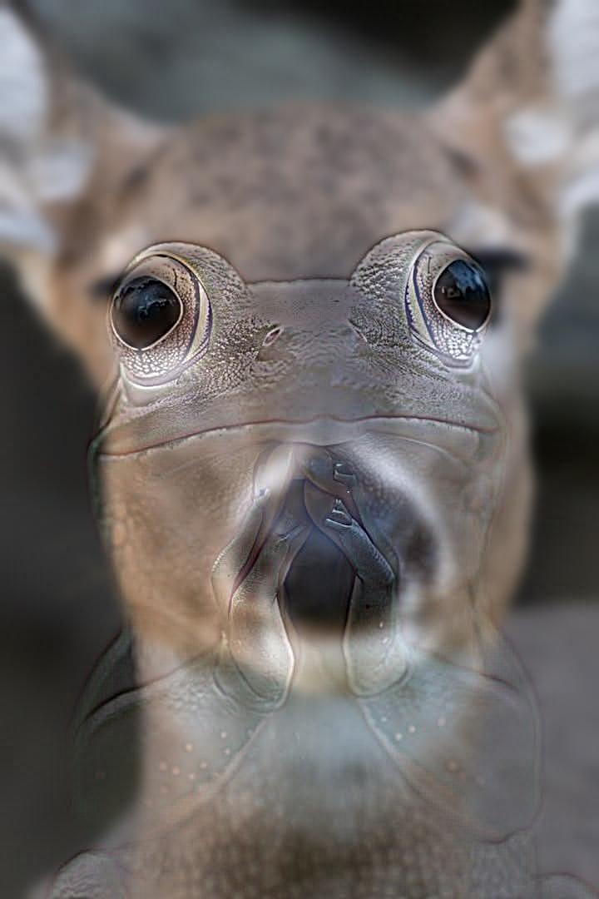 
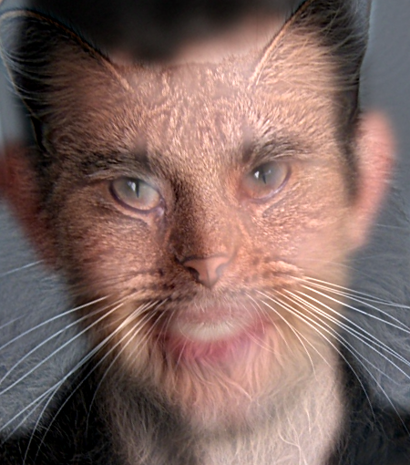 
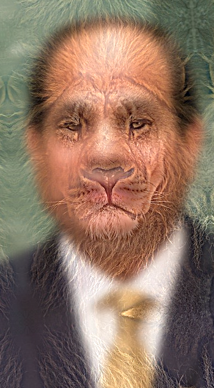

**Tuning sigma:**
- A bigger σ_low blurs the far-away image more, so less of it competes with the other image.
- A bigger σ_high lets more of the second image through, so it shows from farther away. A smaller σ_high keeps only the finest details, so it shows only up close.


**Favorite hybrid, the whole process (man + cat):**

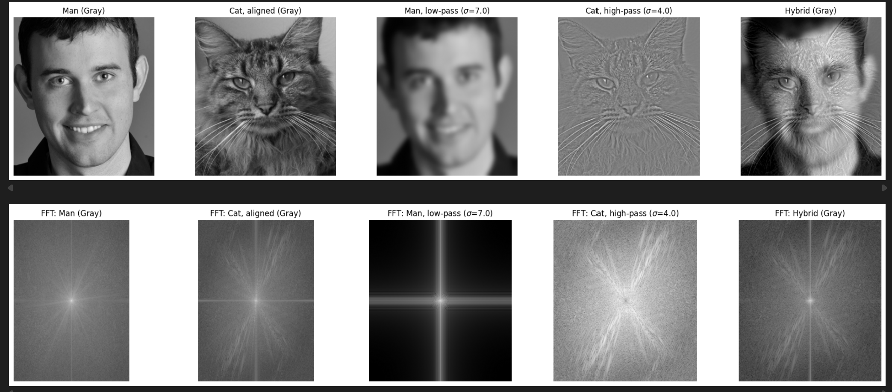

The spectra are computed on the grayscale images with `np.log(np.abs(np.fft.fftshift(np.fft.fft2(gray))))`, so the center is the low frequencies. Observations:
- The man's spectrum is concentrated near the center, and the low-passed man looks the same near the center but fades out toward the edges.
- The cat's high-pass spectrum has a dark region in the center, since the low frequencies were removed, and keeps the outer frequencies.
- The hybrid has the man's central part plus the cat's outer part, so both frequency bands are present.

## 2.2 Aliasing

`rings.png` (grayscale) and shrank it to a quarter of its width and height in two ways: keeping every fourth pixel, and blurring with a Gaussian first and then keeping every fourth pixel. Samples swept at σ = 1, 1.5, 2, 2.25, 2.5 and 3 to find where the false circles disappear. The smallest σ with no false circles was **σ = 2.5** 

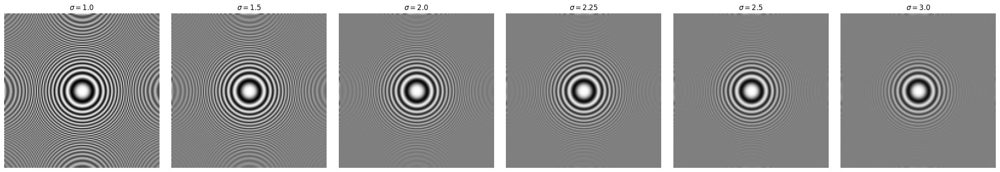

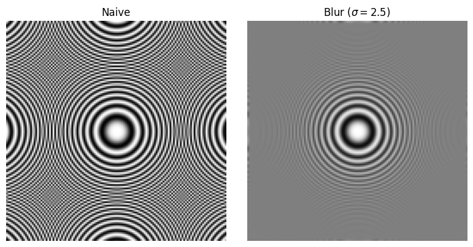

**What happened:**
- **Naive:** keeping every fourth pixel samples the image at 1/4 of its resolution, so the new grid can only represent frequencies below 1/8 cycle per original pixel. The finer rings are not simply lost. Their frequency folds back into lower frequencies, so they appear as false circles that were not in the original. This is aliasing.  

- **Blur first:** the Gaussian removes most of the frequencies above what the new grid can represent before sampling. A Gaussian with standard deviation σ keeps a fraction exp(−2π²σ²f²) of the amplitude at frequency f. At f = 1/8 cycle per pixel, which is the limit of the new grid, that is 73% for σ = 1 but only 15% for σ = 2.5 (calculated from the formula, and checked against the discrete kernel used). The frequencies that actually alias, above 1/8, are cut much harder, so there is almost nothing left to alias and no false circles show up. The price is that the rings that were too fine for the small image become smooth gray, which is detail that can't be represented anyway.

**What this means for a Gaussian pyramid:** every level has to be blurred before it is subsampled, never subsampled directly. The blur must also be strong enough for the factor. For a factor of 2, the [1 4 6 4 1]/16 kernel has σ = 1, and for a factor of 4, we needed about 2.5, so sigma grows with the subsampling factor.

## 2.3 Gaussian and Laplacian pyramids

Code is in `pyramids.py`. Both functions blur with [1 4 6 4 1]/16 along x and y (using separable convolution in `convolution.py`, reflect padding).

- **reduce:** blurs the image, then keeps every other row and column.
- **expand:** places each pixel at the top left of a 2 × 2 block of zeros (inserting px at every 2nd a col & row), blurs, and multiplies by 4. Three pixels out of four are zeros, so without the factor 4 (smoothing) the image would come out four times too dark. 
- **Padding:** reflect padding, because zero padding would darken the border at every blur.
- **Kernel:** the 5 × 5 kernel is the outer product of [1 4 6 4 1]/16 with itself, so it has rank 1 and `conv2d_sep` runs it as two 1D passes. Its variance is exactly 1, so it approximates a Gaussian with σ = 1. 
- **Color:** color images are processed one channel at a time.
- **Odd sides:** when a side is odd, expanding gives one row or column too many, the last one is dropped.

`mosque.jpg` is used, cropped to 407 × 611, so both sides are odd and neither is a power of 2. With 4 reductions the Gaussian pyramid has 5 levels:

`407 × 611 -- 204 × 306 -- 102 × 153 -- 51 × 77 -- 26 × 39`

The odd handling shows up at most levels. For example, G1 (204 × 306) expands to 408 × 612, which is one row and one column too many for 407 × 611, so the extra ones are dropped. G3 (51 × 77) expands to 102 × 154, and only the extra column is dropped.

**Pyramids:** the Gaussian pyramid applies reduce repeatedly. The Laplacian pyramid subtracts from each Gaussian level the next level expanded to its size, and ends with the smallest Gaussian level itself. To rebuild, we start from the smallest level and repeat: expand, then add the Laplacian level of that size.

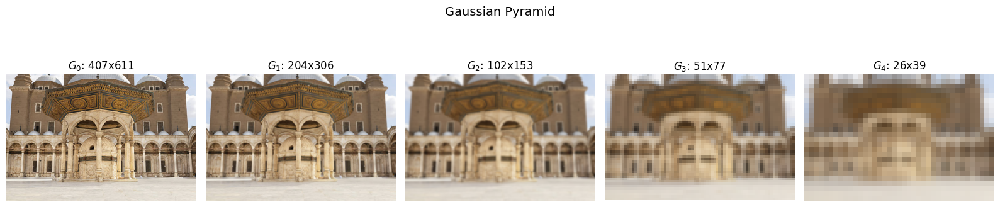

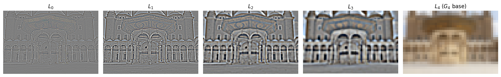

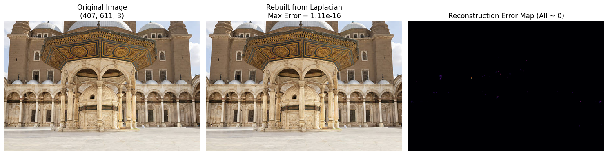

The rebuilt image has the same size as the original (407 × 611), with a maximum absolute error of 1.1e-16 and a mean of about 1e-20. That is floating-point rounding, so the rebuild is exact.

**Why the rebuild is exact:** each Laplacian level is defined as L_k = G_k − expand(G_{k+1}), so G_k = L_k + expand(G_{k+1}) is true by definition, whatever expand does. Rebuilding applies the same expand with the same target size at every step, so each step undoes exactly the subtraction made when building. The only error is rounding.

**Lecture 3's version is not exact:**There the residual is L_i = G_i − blur(G_i), and the next level is built by subsampling blur(G_i). To rebuild, we would need blur(G_i), but we only have a half-size subsampled copy of it. Expanding that copy gives an interpolation, not the original blurred image, because the samples dropped by subsampling were never stored. The residual was measured against a quantity the decoder cannot recompute, so the terms do not cancel and the rebuilt image has error.

**Size:** each level has a quarter of the pixels of the one before, so the Gaussian pyramid has N · (1 + 1/4 + 1/16 + …) = 4N/3 pixels in the limit, about 1.33 times the image. Measured on the mosque with 5 levels it is 1.334. That is slightly above the five-term sum of 1.332 because odd sizes round up when reducing. The Laplacian pyramid has the same level sizes, so it costs the same.

## 2.4 Multiresolution blending

Two images are blended along a mask (white for first image, blackfor second):
- Built the Laplacian pyramids L1 and L2 of the two images, and the Gaussian pyramid of the mask.
- At each level, theyre combined as M·L1 + (1 − M)·L2, with M the mask's level of that size.
- Rebuilded the result from the combined pyramid, as in 2.3.

The mask itself stays sharp. Its Gaussian pyramid softens it, a little at the fine levels and a lot at the coarse ones.

**The three blends:**
- **Oraple:** `apple.jpg` and `orange.jpg` from the starter pack, mask with the left half white, 5 levels.
- **Glazed donut + sprinkle donut:** aligned `donut.jpg` to `glazed.jpg` with `align_images.py` using two points on each . The mask is an ellipse drawn with `cv2.ellipse`, centered on the image, with half-axes 0.18 × width and 0.38 × height. 7 levels.
- **Egyptian pound + euro:** aligned `gneh.jpg` to `euro.png` using two points. The mask is an ellipse drawn with `cv2.ellipse`, centered, with half-axes 0.38 × width and 0.28 × height. 5 levels.

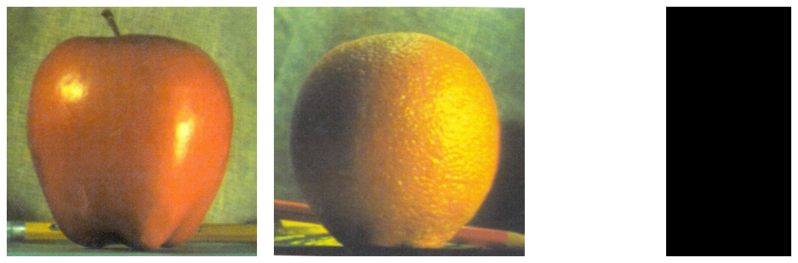
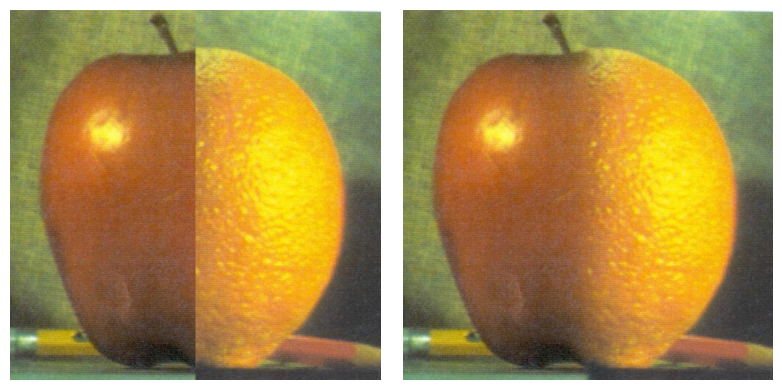

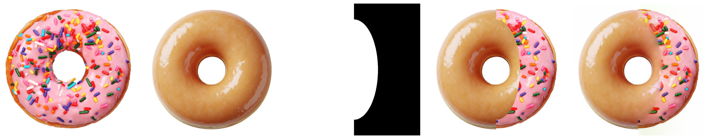


**Number of levels:** too few levels leave the seam visible, because even the coarsest level of the mask is still fairly sharp. Too many levels spread the coarse structure over most of the image, which washes out a small pasted object. 

- **Levels meaning:** `levels = n` means n reductions, so each pyramid has n + 1 images (G0 to Gn). 
- Oraple: 5 (the function default)
- Glazed + donut: 7
- Gneh + euro: 5

- **How much the mask softens:** the mask's pyramid is built with the same reduce, so its edge gets blurrier at every level. At level 0 it stays sharp, at level 1 it is blurred by about 1 pixel, and the blur roughly doubles at each level. The finest band therefore switches at the sharp mask edge, and the coarsest bands switch over tens of pixels.

- **Why too many levels wash out a small object:** in the glazed + donut blend with 7 levels the coarsest band switches over a large part of the ellipse, so its color and brightness blur into the surroundings.

- **Clipping:** blending can overshoot slightly outside [0, 1], so the blended result is clipped. The rebuild in 2.3 is not clipped, which is why its error is only rounding.

**Favorite (glazed + donut):**

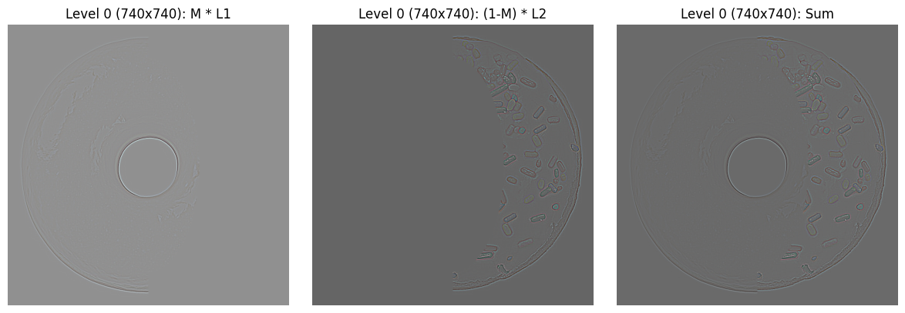
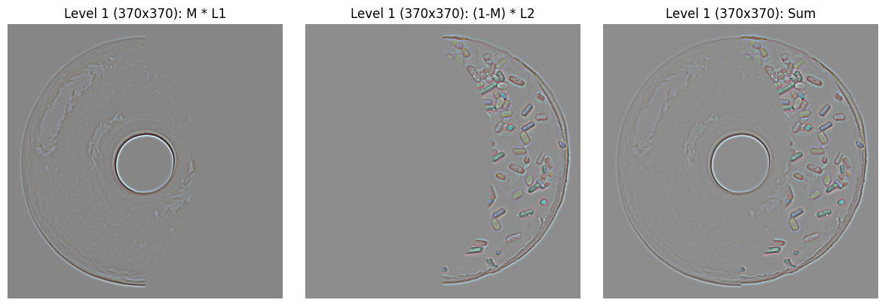
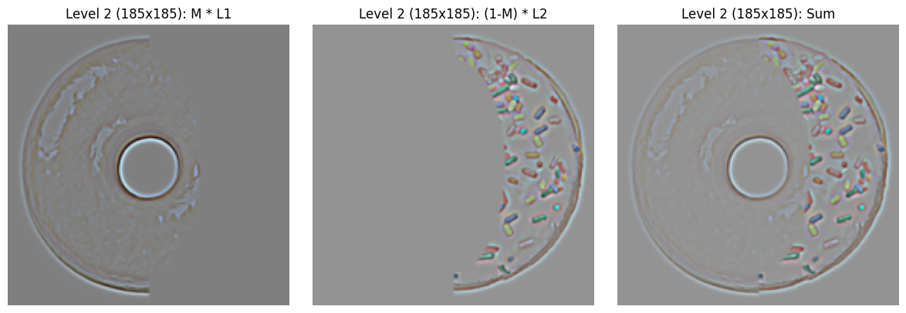
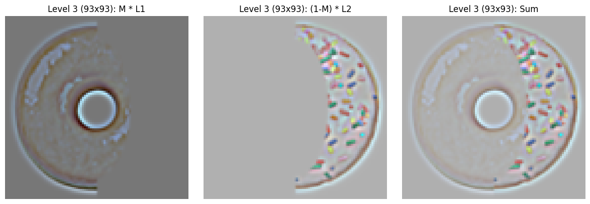
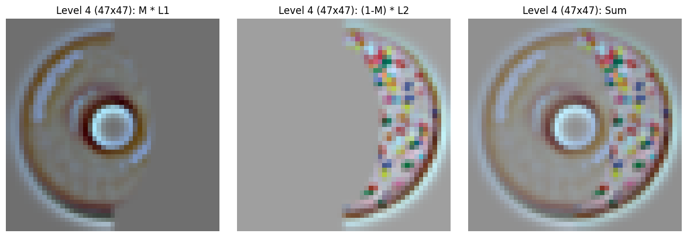
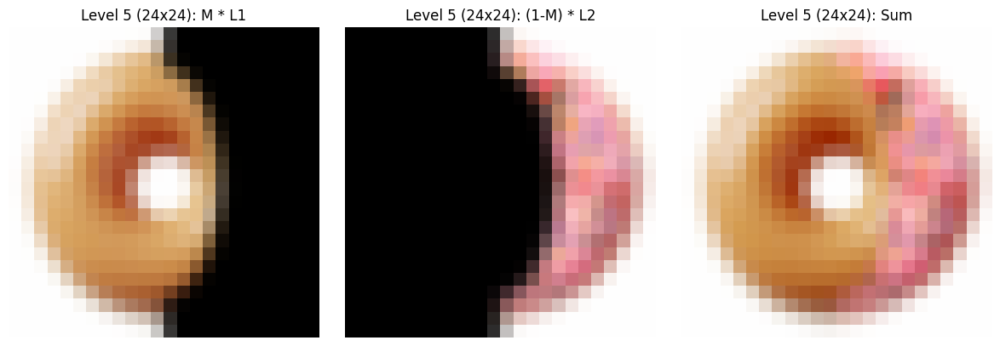

**Why blending band by band hides the seam:** the hard cut switches from one image to the other at a single sharp line, so the whole difference between the two images, in every frequency, is visible along that line. Here each frequency band is blended over its own width. The fine levels, which hold edges and texture, switch over a narrow band, so details stay sharp. The coarse levels, which hold colors and brightness, switch over a wide band, which hides the difference in lighting and color between the images. Mixing the coarse levels gradually removes the visible step, while the fine detail of each image stays intact on its own side.
## Part 3: Seam Carving
### 3.1 Finding and Removing Seams
A seam is a connected path of pixels on an image vertically or horizontally, where the optimal seam is defined by an energy function. 
#### Methodology:
Finding seams uses dynamic programming by default. This is because the brute force approach has a time complexity of O(3^M) for an M x N image, where 3 is the number of choices: left, center and right. With such complexity, it would not even be possible to perform the coomputation on a computer.
On the other hand, using dynamic programming reduces the cost to O(M x N).

Initially, *broadway_tower.png* is used as an example to visualize the energy computation (which is set to the gradient magnitude by default), visualize the highlighted seams and the reduced image output

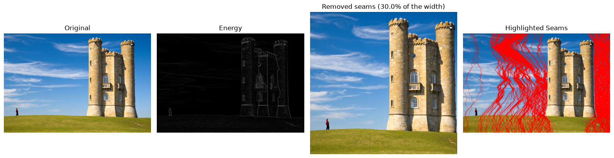

### 3.2 Results and Comparisons
#### First Comparison: Reduction Method
Seam carving's outputs are measured against those of resizing and cropping respectively, with a constant reduction ratio of 30%.
It is clearly observed that in frequent cases, seam carving is the most accurate for preserving image features, where cropping clips the images' borders thus discarding features blindly and resizing clearly distorts the output. Use *broadway_tower.png* and *1665_Girl_with_a_Pearl_Earring.jpg* as an example.
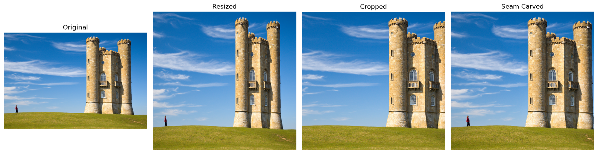
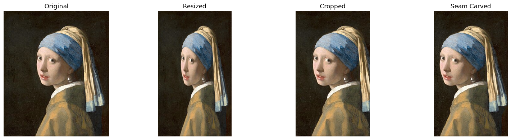

However, seam carving has been shown to be inaccurate when applied to condensed images (Avidan & Shamir, 2007), as shown in *snow.png*. In addition, this inaccuracy is also prominent when applied to flat-texture images, such as *blue_fish.png*.
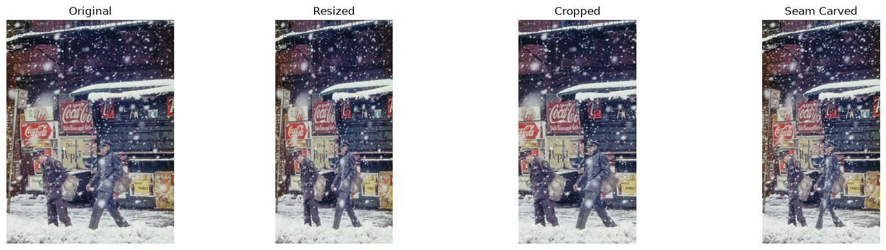
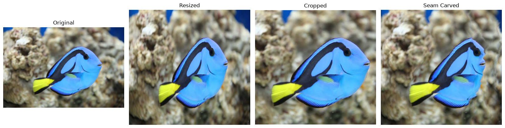

#### Second Comparison: Energy Functions
Three energy computation functions were tested for seam detection:
* Gradient Magnitude
* Finite Differences
* Derivative of Gaussian (DoG)

Gradient magnitude's and finite differences' seams were almost identical, while DoG's seams showed slight difference, and even a minor distortion in fine details: such as discontinuities. This is primarily due to the blurring effect of DoG before computing the energy. The discontinuity effect is prominent in *starry_night.jpg* and *rocket.jpg*
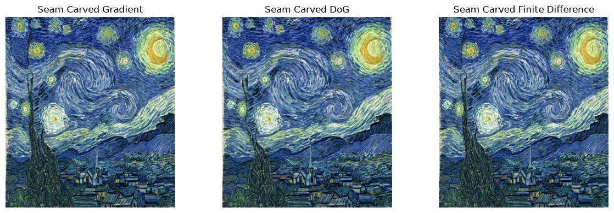
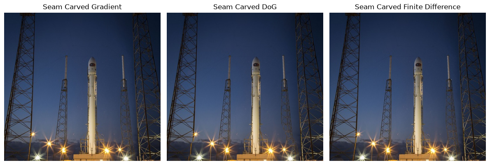

---
## Bonus
### Object Removal
The user selects an object to remove using `matplotlib` widget while keeping the original image size. The widget creates a resizeable elliptical mask surrounding the object. Seam carving is used to reduce the discontinuities caused by such process. The implementation is found in the `remove_object()` function and it is demonstrated briefly as follows: 
- The image is copied into `working_img`
- Cheapest seams are removed iteratively from the mask and `working_img`
- `working_img`is copied into `seam_copy`, then the cheapest seams of the current `seam_copy` are used to generate new pixels by averaging and they are removed from `seam_copy` afterwards

The copy (`seam_copy`) is used to find insertion locations and it is shrunk every iteration to discard used seams. Choosing the cheapest seam from the same image (`working_img`) and appending it iteratively would affect the image's energy calculation based on synthetic pixels and not the original pixels which are present in the reduced image copy.
The test performed on `broadway_tower.png` is shown below
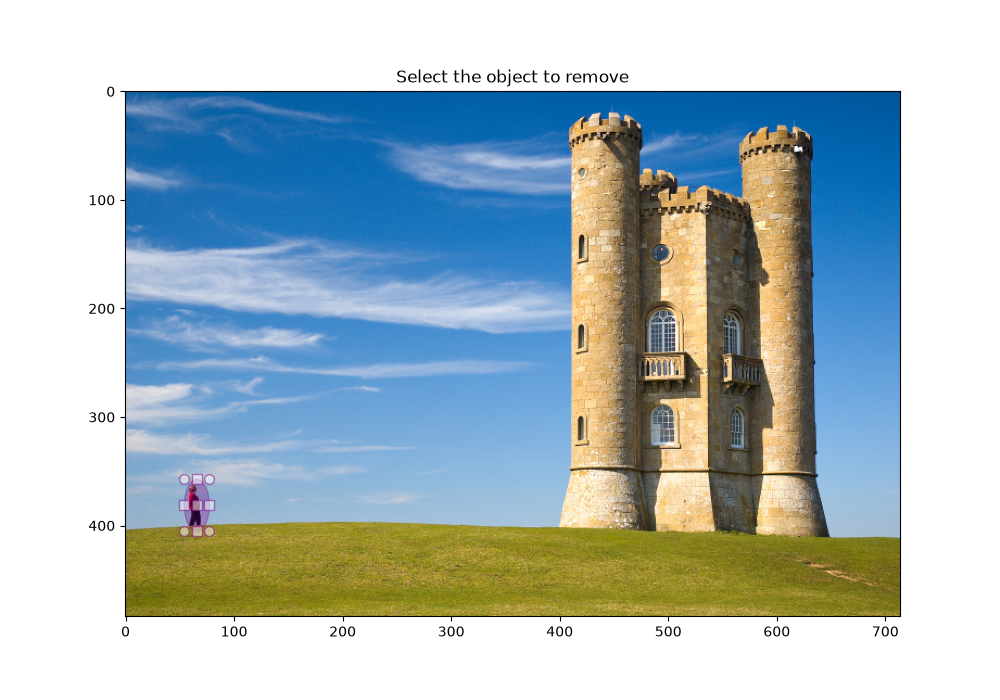
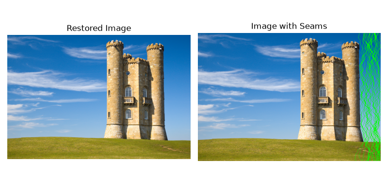

